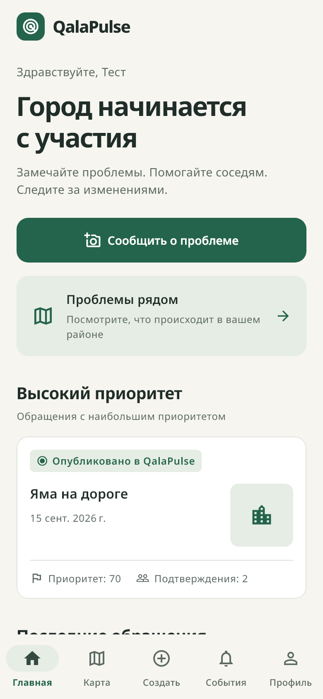
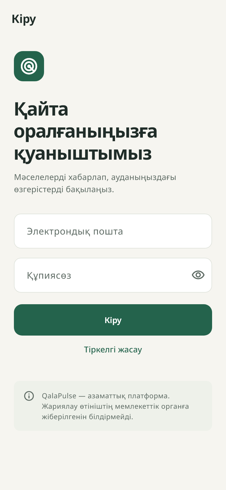
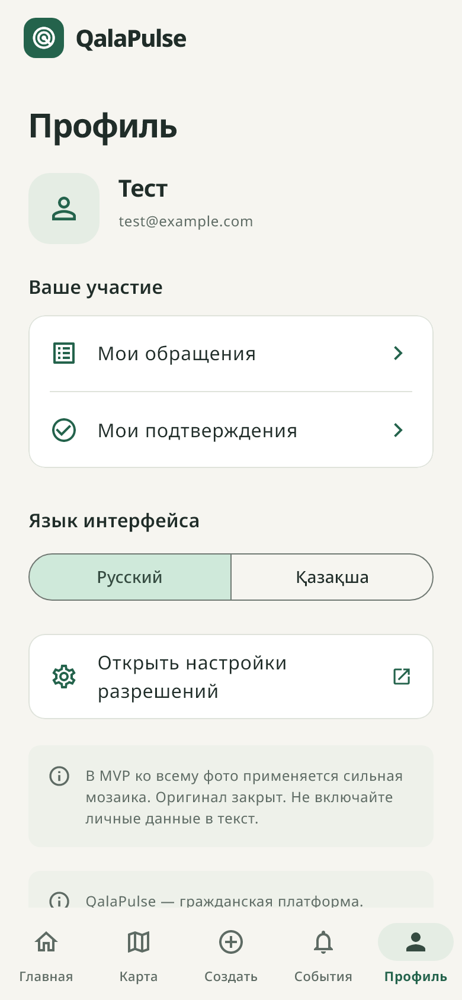
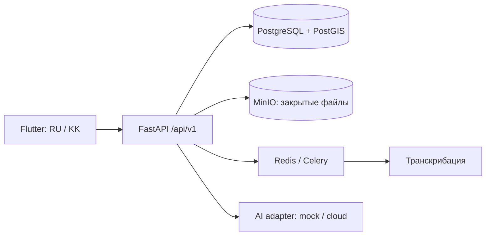

# QalaPulse

### Замечайте проблемы. Помогайте соседям. Следите за изменениями.

**QalaPulse — мобильное приложение для жителей Казахстана: сообщить о городской проблеме с фотографией и точкой на карте, поддержать обращение соседа и увидеть историю его решения.**

Ямы на дороге, открытые люки, мусор, неработающие фонари и утечки воды становятся понятными обращениями в общей ленте и на карте. AI помогает подготовить описание, а пользователь проверяет его перед публикацией. Похожие обращения можно подтвердить вместо создания ещё одной копии.

**Статус:** MVP для локальной демонстрации и подготовки закрытого пилота. Интерфейс приложения — русский и казахский. Основной сценарий запускается без платных AI-сервисов и внешних ключей.

> QalaPulse — независимая гражданская платформа. Публикация в приложении **не означает отправку обращения в государственный орган**. Реальных государственных интеграций в этой версии нет.

[Запустить проект](#быстрый-запуск) · [Архитектура](docs/architecture.md) · [API](docs/api.md) · [Дизайн и прототип](docs/lab5-6/README.md) · [Ограничения](#что-важно-знать-о-mvp)

## Как выглядит приложение

<p>
  
  
  
</p>

Снимки Flutter-интерфейса из widget-тестов с синтетическими данными. Они показывают реализованный дизайн, а не результаты реального пилота.

## Для кого и зачем

| Кому | Что даёт QalaPulse |
|---|---|
| Жителям | Один сценарий для фотографии, адреса и описания; возможность отслеживать проблему и подтверждать её актуальность |
| Соседям | Карта проблем района и возможность поддержать существующее обращение |
| Модераторам | Проверка содержимого, жалобы, категории и объединение дубликатов через API |
| Подключённым организациям | Назначение работ, ответы и изменение статусов через API; принятие обращения фиксируется после действия организации |

## Как это работает

1. **Зафиксировать проблему:** сделать фото или выбрать его из галереи.
2. **Указать место:** получить GPS-позицию или выбрать точку вручную.
3. **Добавить описание:** написать текст либо записать голос и проверить транскрипт.
4. **Проверить AI-предложение:** исправить категорию, заголовок, описание и опасность.
5. **Посмотреть похожие обращения:** подтвердить существующее или создать новое.
6. **Опубликовать:** обращение появляется в ленте и на карте QalaPulse.
7. **Следить за результатом:** читать комментарии и историю, подтверждать актуальность или сообщать о решении.

При сбое сети черновик остаётся на устройстве. Повторная публикация использует тот же ключ идемпотентности — идентификатор запроса, защищающий от случайных копий.

## Что реализовано

- **Мобильный интерфейс:** главная, карта, лента, создание обращения, детали, события и профиль; локализация RU/KK, общий набор компонентов и локально подключённый Noto Sans.
- **Обращения:** семь категорий из базы, фото, координаты, текст, голос, комментарии, подтверждения и жалобы.
- **Карта:** OpenStreetMap, кластеры, фильтры, поиск в выбранной области и обновление после публикации.
- **AI:** предсказуемый mock-режим и отдельный cloud-адаптер; проверка схемы ответа, таймауты, повтор запросов и ручная коррекция.
- **Поиск дубликатов:** PostGIS, расстояние, категория, время и текстовое сходство; без автоматического объединения.
- **Приоритет:** прозрачная формула на основе категории, опасности, подтверждений, времени и тестовых чувствительных зон.
- **Доступ:** регистрация, вход, JWT, ротация refresh-токенов, безопасное хранение токенов на устройстве и четыре роли.
- **Backend:** история статусов, назначения организациям, модерация, аудит, ограничения запросов, health/readiness и метрики.
- **Разработка:** Docker Compose, миграции, демо-данные, автоматические тесты и GitHub Actions без реальных AI-ключей.

### Статусы без ложных обещаний

| Статус | Что означает |
|---|---|
| `published` | Опубликовано в QalaPulse |
| `under_review` | Проверяется модератором |
| `accepted` | Принято назначенной организацией внутри платформы |
| `in_progress` | В работе |
| `resolved_pending_confirmation` | Отмечено как решённое, ожидает проверки |
| `resolved` | Решение подтверждено |
| `rejected` | Отклонено |

## Технологии и устройство проекта

| Слой | Технологии |
|---|---|
| Mobile | Flutter, Dart, Material 3, Riverpod, GoRouter, Dio, Freezed, secure storage |
| API | Python 3.13, FastAPI, Pydantic 2, SQLAlchemy 2, Alembic |
| Данные и фоновые задачи | PostgreSQL + PostGIS, Redis, Celery, MinIO |
| AI | Абстракции анализа фото, транскрибации, дубликатов и приватности; mock / OpenAI-совместимый API |
| Проверки | pytest, Ruff, mypy, Flutter tests, GitHub Actions |



```text
mobile/                    Приложение, локализация, компоненты и тесты
backend/                   API, модели, миграции, AI-адаптеры и тесты
infrastructure/            Контейнеры и эксплуатация
docs/                      Архитектура, API, пилот, дизайн и прототипы
  lab4/                    Wireframes и интерактивные элементы
  lab5-6/                  Дизайн-система и Figma-плагин с переходами
sample_data/               Собственные синтетические изображения
scripts/                   Настройка, интеграционные тесты, генераторы материалов
output/pdf/qalapulse/       Презентационный one-pager: PDF и редактируемый HTML
.github/workflows/         CI
```

Основная сущность — `Incident`. Сейчас реализован источник `citizen`; модель предусматривает инспекторов и камеры, но их подключение ещё не реализовано.

## Быстрый запуск

### 1. Backend и демо-данные

Нужны Git, Python для скрипта настройки и запущенный Docker Desktop/Engine с Linux containers. Backend работает в контейнере Python 3.13.

```bash
git clone https://github.com/Madi-afk/Qala-Pulse.git
cd Qala-Pulse
python scripts/setup_env.py
docker compose up --build -d --wait
docker compose exec backend python -m app.seed
```

Скрипт создаёт `.env` со случайными локальными секретами и не перезаписывает существующий файл. Миграции применяются при старте backend. Seed добавляет 7 категорий, 28 синтетических обращений в Алматы, комментарии и подтверждения.

| Сервис | Адрес |
|---|---|
| Swagger / интерактивная документация API | http://localhost:8000/docs |
| Health | http://localhost:8000/api/v1/health |
| Готовность PostgreSQL, Redis и MinIO | http://localhost:8000/api/v1/ready |
| MinIO console | http://localhost:59001 |

Если `backend is not running`, проверьте `docker compose ps` и `docker compose logs --tail=100 backend` перед запуском seed. [Подробное руководство](docs/development.md) и [диагностика Docker в Windows](docs/local-docker-recovery.md).

### 2. Flutter

Для воспроизводимой среды CI используется Flutter **3.44.1**. Для Android нужны Android SDK и эмулятор либо телефон с USB-отладкой; сборка iOS требует macOS и Xcode.

```bash
cd mobile
flutter pub get
flutter gen-l10n
dart run build_runner build
flutter run --dart-define=API_BASE_URL=http://10.0.2.2:8000/api/v1
```

`10.0.2.2` — адрес компьютера из Android Emulator. На Android по USB:

```bash
adb reverse tcp:8000 tcp:8000
flutter run --dart-define=API_BASE_URL=http://127.0.0.1:8000/api/v1
```

Если PowerShell не находит `adb`, используйте полный путь:

```powershell
& "$env:LOCALAPPDATA\Android\Sdk\platform-tools\adb.exe" reverse tcp:8000 tcp:8000
```

Для телефона по Wi-Fi задайте адрес компьютера в локальной сети и такой же доступный `PUBLIC_API_URL` в `.env` для фотографий. Перед реальным пилотом требуется HTTPS. [Дополнительные команды для web, APK и настройки окружения](docs/development.md).

### Демо-аккаунты

После seed общий **исключительно тестовый** пароль: `QalaPulse-Demo-2026!`.

| Роль | Email |
|---|---|
| Житель | `citizen@qalapulse.example.com` |
| Модератор | `moderator@qalapulse.example.com` |
| Организация | `organization@qalapulse.example.com` |
| Администратор | `admin@qalapulse.example.com` |

Это локальные демонстрационные учётные записи. Для реальных данных используйте отдельный контур и собственные аккаунты.

## AI: демонстрация и внешний провайдер

По умолчанию в `.env` стоит `AI_MODE=mock`. Ключи не нужны: анализ и транскрипт предсказуемы. **Mock не распознаёт реальную фотографию или речь** — он позволяет проверить пользовательский сценарий.

Для внешнего OpenAI-совместимого провайдера задайте в локальном `.env`:

```dotenv
AI_MODE=cloud
AI_BASE_URL=https://your-provider.example/v1
AI_API_KEY=your-private-key
AI_VISION_MODEL=your-vision-model
AI_TRANSCRIPTION_MODEL=your-transcription-model
```

Затем выполните `docker compose up -d --force-recreate backend worker`. В приложении требуется согласие на внешнюю обработку. При ошибке провайдера доступен явно обозначенный mock-fallback. Результат в любом режиме проверяет человек. [Все настройки AI](docs/development.md).

## Дизайн, прототипы и презентация

| Материал | Содержание |
|---|---|
| [Редизайн приложения](docs/ui-redesign.md) | Реализованные Flutter-экраны, компоненты, доступность и проверки |
| [Lab 4](docs/lab4/README.md) | Wireframes, дополнительные функции и интерактивные элементы |
| [Lab 5–6](docs/lab5-6/README.md) | Палитра, типографика, 61 компонент, 20 экранов и 20 состояний overlays; локальная проверка 123 переходов |
| [Демонстрация прототипа](docs/lab5-6/DEMONSTRATION.md) | Сценарий защиты и чек-лист пользовательского тестирования |
| [One-pager](docs/presentation.md) | PDF о продукте, редактируемый HTML и исходники генератора |

Figma-плагин добавляет редактируемые слои на текущую страницу и учитывает лимит Starter. Исправлено дублирование точек старта; предусмотрено восстановление частичной сборки. Успешное завершение последней версии в самом Figma ещё не подтверждено. Английский учебный прототип использует демонстрационные данные и не заменяет работающий Flutter-клиент.

## Тестирование

Backend, из активированного Python 3.13 окружения:

```bash
cd backend
python -m pip install -r requirements.lock -e ".[dev]"
ruff check .
ruff format --check .
mypy app
pytest -q -m "not integration"
```

Flutter, из `mobile/`:

```bash
flutter analyze
flutter test
dart format --output=none --set-exit-if-changed lib test
```

Реальные интеграционные проверки PostgreSQL/PostGIS, MinIO, Redis и Celery запускаются командой `python scripts/run_integration.py` из корня. Скрипт создаёт отдельный временный контур; unit-тесты на SQLite не заменяют эти проверки.

[GitHub Actions](https://github.com/Madi-afk/Qala-Pulse/actions) · [Проверки этого обновления](docs/release-checks-2026-10-19.md) · [История исправлений Android](docs/android-pilot-fixes.md).

## Что важно знать о MVP

- **Фото обрабатываются локально:** найденные лица и номера скрываются, детали дороги сохраняются. Есть предпросмотр с увеличением и ручное полное размытие; при сбое детектора весь кадр размывается автоматически. Контрольные примеры проверены, но качество на реальных номерах Казахстана ещё требует оценки. [Результаты и ограничения](docs/photo-privacy.md).
- Качество cloud AI на русской и казахской речи и реальных городских фото ещё нужно измерить. Чувствительные зоны для приоритета пока синтетические.
- Есть один локальный черновик на пользователя и ручной повтор отправки. Полной офлайн-карты и фоновой отправки из закрытого приложения нет.
- Уведомления пока загружаются из API. FCM архитектурно подготовлен, но не настроен. Отдельной web-панели организации или модератора нет.
- Не реализованы восстановление пароля, MFA и автоматический retention файлов. Для пилота нужны резервное копирование, HTTPS, мониторинг и процедуры работы с персональными данными.
- Приёмку камеры, GPS, микрофона и полного сценария на физических устройствах, нагрузочные тесты и пользовательское тестирование необходимо проводить отдельно.

## Ближайшие задачи

1. Проверить основной сценарий на реальных Android/iOS и завершить пользовательскую проверку Figma-прототипа.
2. Расширить проверку локального скрытия лиц и номеров на постановочных снимках в условиях пилота; измерить пропуски и потерю полезных деталей.
3. Добавить рабочую панель организаций и модераторов.
4. Подготовить восстановление доступа, очистку файлов и эксплуатацию пилота.
5. Подключить push-уведомления и измерить результаты закрытого пилота.

[Приватность](docs/privacy.md) · [Пилот и метрики](docs/pilot.md) · [Готовность к интеграциям](docs/government-readiness.md) · [Эксплуатация](infrastructure/README.md).

## Лицензия

Код проекта — [MIT](LICENSE). Шрифты Noto Sans и Inter распространяются со своими OFL-лицензиями в соответствующих каталогах. OpenStreetMap и зависимости сохраняют свои требования к лицензированию и атрибуции.
