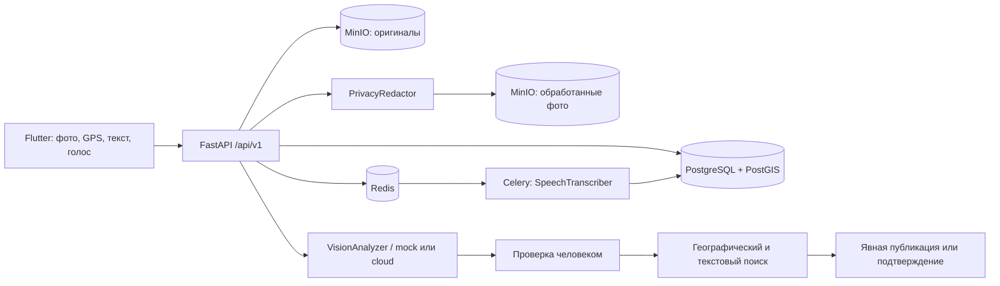

# Архитектура QalaPulse

## Компоненты

Модульный монолит FastAPI + PostgreSQL 17/PostGIS, Redis и Celery для аудио, MinIO для файлов. Flutter использует Riverpod, GoRouter, Dio, Freezed/json_serializable и Material 3. Документы API доступны в `/docs`, машиночитаемая схема — `/openapi.json`.

## Создание обращения

1. Локальный черновик разделён по ID пользователя. Фото копируется из временного каталога в документы приложения; web-demo хранит фото в base64. GPS необязателен: точка выбирается на карте или координатами.
2. Загрузка проверяет размер, MIME и декодирование фото. Имена случайные. EXIF не попадает в публичную версию. `PrivacyRedactor` локально маскирует найденные лица/номера через заменяемый `RegionDetector`; при сбое применяется полная мозаика. Пользователь проверяет увеличиваемый предпросмотр и может запросить полное размытие. [Алгоритм и контрольные примеры](photo-privacy.md).
3. AI возвращает предложение, режим (`mock`/`cloud`), признак fallback и обязательность проверки. Внешняя обработка требует установленного cloud-режима **и** согласия пользователя в запросе. Оригинал перед отправкой преобразуется в JPEG без метаданных.
4. Пользователь редактирует категорию, заголовок, описание, опасность. Даже отсутствие распознанной городской проблемы не запрещает ручной ввод.
5. Поиск кандидатов не меняет обращения. Пользователь подтверждает существующий Incident либо публикует новый.
6. До первого POST `/incidents` черновик сохраняет неизменяемый payload и ключ. Таймаут после успешного commit можно безопасно повторить после перезапуска приложения.
7. Блокировка строки пользователя и уникальность `(user_id, key)` сериализуют конкурентные публикации. Другой payload с тем же ключом получает 409. Файл нельзя опубликовать в нескольких обращениях.
8. Окончательный бизнес-отказ 422 записывает `PublicationCancellation` до ответа. Отмена неизвестного исхода использует ту же блокировку: возвращает существующий Incident или сохраняет запрет на ключ. Только после этого клиент разблокирует редактирование/удаление черновика. Неопределённый сетевой исход сохраняет старый payload и ключ.

`is_published=false` обозначает серверный черновик и скрывает его от публичных маршрутов. Публичного статуса «draft» нет. PATCH разрешён только автору до публикации.

## Приоритет

`base_category_severity*4 + severity*3 + min(confirmations,20)*1.5 + max(0,10-age_days) + sensitive_location_score`.

`severity` — проверенная человеком опасность, первоначально предложенная AI. Компоненты и RU/KK объяснение возвращаются в `priority_explanation`. Зоны чувствительных мест **синтетические**, не являются проверенным реестром школ или больниц. Расчёт хранится в БД и обновляется при изменении обращения/подтверждении; временная составляющая между такими изменениями может устаревать. Для масштабного пилота нужен периодический пересчёт.

## Дубликаты

Сначала PostGIS `ST_DWithin(geography, geography, meters)`, категория и последние 30 дней, затем до 100 кандидатов. GiST индекс хранится в миграции. Закрытые, решённые и отклонённые обращения не предлагаются как активные дубликаты.

Итог: `geo*0.40 + text*0.30 + category*0.20 + time*0.10`; порог 0.66, радиус 250 м. Mock использует Jaccard по нормализованным словам. Cloud при настроенном `AI_EMBEDDING_MODEL` и согласии использует cosine embeddings, при сбое возвращается к локальному сравнению. Фото в этом расчёте пока не участвует: `image_similarity=null`.

Подтверждать может только citizen. Счётчик поддержки увеличивается только при первом `still_exists` данного жителя за всю историю Incident. Новый переход организации в `resolved_pending_confirmation` открывает новый `resolution_cycle`; уникальность подтверждения включает цикл и тип. Житель может оспорить очередной ремонт независимо от прежней поддержки. Изменение статуса и вставка подтверждения выполняются под блокировкой Incident. Модератор может явно объединить два обращения: источник скрывается, сохраняются связь и аудит; комментарии и подтверждения остаются у исходного Incident, чтобы не искажать авторство и счётчики.

## Авторизация и права

Пароли Argon2id. JWT access живёт 15 минут и проверяет issuer, audience и type. Refresh — случайный непрозрачный токен; БД хранит только SHA-256 и семейство. При каждом refresh старый токен отзывается. Повтор отозванного токена отзывает семейство. Flutter хранит сессию одним объектом в `flutter_secure_storage`, выполняет единственный refresh для параллельных 401 и повторяет запрос с новым access.

DB dependency использует `scope="function"`: commit заканчивается до отправки HTTP-ответа, поэтому следующий запрос с только что выданным JWT видит зарегистрированного пользователя. Ошибка commit не может сопровождаться уже отправленным успешным ответом. Сериализация завершается до закрытия сессии; потоковых ответов, читающих БД после этого, нет.

Logout отзывает refresh-семейство; выданный access живёт до своего срока. При офлайн-выходе Flutter удаляет локальную сессию, но серверный отзыв требует связи. Роль читается из БД на каждом запросе. Организация меняет только назначенные ей обращения. `accepted` не означает принятие государственным органом.

`SessionManager` сериализует записи secure storage и уведомляет AuthController. Refresh 401 завершает сессию и показывает переход ко входу; временный сетевой сбой сохраняет её. Номер поколения сессии и исходный refresh token не позволяют позднему ответу изменить новую сессию. Асинхронные действия черновика привязаны к исходному владельцу.

Карта использует Riverpod family по центру/радиусу/категории. Перемещение сообщает viewport экрану; «Искать здесь» выбирает новый запрос. Общая ревизия Incident обновляет ленту и карту после публикации/подтверждения, ручная кнопка повторяет текущую выборку. Ответ старой family не заменяет новую. Радиус ограничен 20 км, выдача — 200 маркерами с явным предупреждением `has_more`.

## Файлы и аудио

Оба бакета закрыты для anonymous. API выдаёт **только** обработанные изображения и только для опубликованных, не скрытых Incident. Приватный preview владельцу также обработан. Публичного endpoint оригинала нет. Public URL проверяет видимость при каждом запросе и имеет `Cache-Control: no-store`.

Аудио не публикуется. После записи пользователь прослушивает, отменяет/повторяет, отправляет на Celery. Результат хранится в Upload и доступен только владельцу. Job можно повторно поставить в очередь; worker блокирует строку и не обрабатывает готовую транскрипцию второй раз. Mock-транскрипт явно помечен как тестовый.

## Рабочая веб-панель

FastAPI раздаёт `app/console` по `/console/`. Это статический интерфейс на ES-модулях с запросами к тому же origin. Служебный `/api/v1/operations` предоставляет очереди, защищённое медиа, назначения, историю, жалобы и ответы; изменения используют также существующий `/moderation`. Backend проверяет роль и назначенную организацию при каждом действии. Access/refresh находятся только в памяти вкладки. Два параллельных запроса с истёкшим access используют одну ротацию refresh. Подробности: [панель и её проверки](operations-console.md).

## Расширение источников

В API первой версии источник всегда `citizen`, клиент не может подменить его. Модель `Source` предусматривает inspector, bus_camera, municipal_vehicle и cctv. Будущие адаптеры должны иметь отдельную аутентификацию устройства, журнал происхождения, пакетную обработку и проверку приватности. Полученные события станут Incident после определённой политики человеческой проверки. Камерные интеграции не реализованы.

## Источники технических решений

- [PostGIS: ST_DWithin](https://postgis.net/docs/ST_DWithin.html) — расстояния geography в метрах и использование индекса.
- [OpenAI: structured outputs](https://developers.openai.com/api/docs/guides/structured-outputs) — структурированный ответ, дополнительно проверяемый Pydantic.
- [OpenAI: file transcription](https://developers.openai.com/api/docs/guides/speech-to-text) — multipart API транскрибации.
- [Celery: tasks](https://docs.celeryq.dev/en/stable/userguide/tasks.html) — повторная доставка требует идемпотентной обработки.
